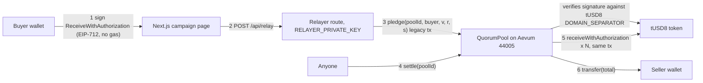

# Pactora

Pactora is pre-orders for small makers. Buyers only sign. When enough orders arrive, every payment is collected in one transaction; if they don't, nobody's money ever moves. Built with Next.js 15, Tailwind CSS v4, viem 2 and a Foundry-tested Solidity contract on Aevum testnet with tUSD8.

> Live demo: https://pactora-smoky.vercel.app

## The problem

A coffee roaster won't fire the drum for a new lot until five bags are sold. A risograph shop needs twenty prints to cover a new master. A tailor buys linen by the full 40 m bolt. All of them sell against a minimum order, and today they collect pre-orders one of two ways:

1. **Take the money up front** and promise a refund if the batch falls through. The buyer carries the risk and the maker inherits a pile of refund chores.
2. **Collect promises** in a group chat. When the threshold is met, roughly half the names go quiet at payment time.

On-chain crowdfunding contracts don't fix this. They lock funds inside the contract, so a failed campaign makes every backer call `refund` on their own and pay gas to get their own money back.

## The solution

Each buyer signs one tUSD8 `receiveWithAuthorization` (EIP-3009) message. The signature fixes four things:

- **recipient**: the Pactora `QuorumPool` contract, and only it can redeem the signature
- **amount**: the price per order
- **validBefore**: the batch deadline, so the authorization expires on its own
- **nonce**: `keccak256(pool, poolId, buyer, round)`, bound to this pool and this buyer

The relayer posts the signature to the pool (the buyer pays no gas). Once the active count reaches the minimum, anyone can call `settle(poolId)`. The contract redeems every authorization in the same transaction and forwards the total to the seller. If any single redemption fails, the whole transaction reverts. If the minimum is never met, the signatures expire and there is nothing to refund, because nothing was ever transferred.

A buyer can change their mind before the deadline by signing a `CancelAuthorization`. The relayer submits it to tUSD8, then calls `withdrawPledge`, which the pool only accepts once the token reports the nonce as used.

## Architecture



| Piece | File | Role |
| --- | --- | --- |
| Contract | `contracts/src/QuorumPool.sol` | createPool, pledge (signature check), withdrawPledge, dropPledge, settle |
| Data adapter | `lib/adapter/` | `getAdapter()`: fake (seed data, default) or real (`ADAPTER_MODE=real`); pages and `/api/campaigns` read through it |
| Seed data | `lib/data/seed.ts` | Eleven fixed maker batches, deterministic placeholder hashes |
| Chain module | `lib/aevum.ts` | Aevum chain config, ABIs, EIP-712 typed data, `loadCampaign` (multicall read, falls back to seed), `getLogsChunked` |
| Relayer | `app/api/relay/route.ts` | Gasless pledge, cancel and settle. Legacy transactions, rate limited, mock hash when unconfigured |
| Workspace | `app/pledge/page.tsx` | Sellers open a batch; the board of all batches |
| Result page | `app/pledge/[id]/page.tsx` | Live counter, signer list, sign / withdraw / collect, on-chain trail, copy link |

## How it uses QDay and Aevum

- **tUSD8 on Aevum testnet** (`0x456569838f1d43009A91ebA4263147Afd7233483`, chain id `44005`): the only token Pactora moves. The whole mechanism depends on its EIP-3009 `receiveWithAuthorization`, `cancelAuthorization` and `authorizationState`.
- **EIP-712 domain** `{ name: "tUSD8", version: "2", chainId: 44005 }`: buyers sign against it in the browser; the pool re-derives the digest from `token.DOMAIN_SEPARATOR()` and rejects any signature that doesn't recover to the buyer.
- **Aevum specifics**: Foundry builds with `evm_version = "shanghai"`, every transaction is legacy (the relayer passes `gasPrice`), and history reads walk `eth_getLogs` in 1,000-block chunks.
- **Multicall3** (`0xcA11bde05977b3631167028862bE2a173976CA11`): one RPC round trip loads a pool, its count and its entrants.

### Testnet addresses

| Contract | Address |
| --- | --- |
| tUSD8 | `0x456569838f1d43009A91ebA4263147Afd7233483` |
| QuorumPool | _filled after deploy_ |
| Multicall3 | `0xcA11bde05977b3631167028862bE2a173976CA11` |

## Safety and controls

- No custody: funds sit in buyer wallets until the single settle transaction.
- Least privilege: a signature can pay one recipient (the pool), one amount, before one deadline.
- Session expiry: `validBefore` equals the deadline.
- Instant revocation: gasless `cancelAuthorization` plus `withdrawPledge`.
- All or nothing: one failed redemption reverts the whole settle.
- Bounded loops: at most 128 orders per pool (`maxOrders <= MAX_ENTRIES / 2`) and 256 distinct entrants.

## Tech stack

Next.js 15 (App Router), TypeScript, Tailwind CSS v4, shadcn-style primitives, viem 2, AutoAnimate and Motion for list and counter transitions, Solidity 0.8.24 with Foundry, Aevum testnet, tUSD8, Vercel.

The 90-second demo path is in [DEMO.md](DEMO.md).

## Quickstart

```bash
npm install
npm run dev          # http://localhost:3000, practice mode on seed data
npm run seed         # prints the seed count and its sha256 (Node 22.6+)
cd contracts && forge build && forge test
```

Practice mode needs no keys: the counter, sign, withdraw and collect flows run against eleven seeded batches and the relayer returns placeholder hashes.

Going live on Aevum:

```bash
cp .env.example .env.local
cd contracts
PRIVATE_KEY=0x... forge script script/Deploy.s.sol --rpc-url https://rpc-test.qday.info --broadcast --legacy
# put the printed address in NEXT_PUBLIC_CONTRACT_ADDRESS, and a funded relayer key in RELAYER_PRIVATE_KEY
```

| Variable | Where it comes from |
| --- | --- |
| `ADAPTER_MODE` | `fake` (seed data, default) or `real` |
| `NEXT_PUBLIC_CONTRACT_ADDRESS` | Output of `Deploy.s.sol` |
| `NEXT_PUBLIC_CHAIN_ID` | `44005` |
| `NEXT_PUBLIC_AEVUM_RPC` | `https://rpc-test.qday.info` |
| `NEXT_PUBLIC_EXPLORER_URL` | Aevum explorer base URL (confirm in the QDay Discord) |
| `NEXT_PUBLIC_TUSD8_ADDRESS`, `NEXT_PUBLIC_TUSD8_DECIMALS` | aevum-starter-kit README, `cast call ... "decimals()"` |
| `RELAYER_PRIVATE_KEY` | A testnet wallet funded from faucet.qday.info |
| `NEXT_PUBLIC_SITE_URL` | Your Vercel domain |

## Known constraints

- The starter kit documents tUSD8 as EIP-3009 but doesn't spell out `receiveWithAuthorization` and `cancelAuthorization`. If either is missing, the fallback is `transferWithAuthorization` with `to = pool`, documented here once tested.
- A buyer who empties their wallet after signing reverts the whole settle. The seller calls `dropPledge` on that buyer and settles the rest.
- The Aevum explorer verifier has been unreliable. The deployed address and commit hash go here either way.

## What we would build next

- Foundry tests for below-threshold, post-deadline, cancelled, front-run and empty-wallet cases.
- Per-signature balance warnings on the campaign page, read through Multicall3.
- Receipts built from `Pledged` and `Settled` logs via `getLogsChunked`.
- A seller embed: one script tag that drops a live counter onto an existing shop page.
- Post-quantum signing on QDay mainnet once its ML-DSA precompile ships.

## AI use

> Adjust this section to the hackathon's disclosure rules.

We used AI coding assistants for scaffolding and boilerplate. Architecture, product decisions, and final code review are our own.

## License

MIT
