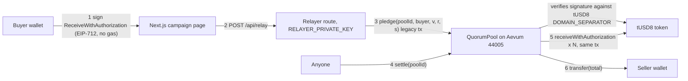
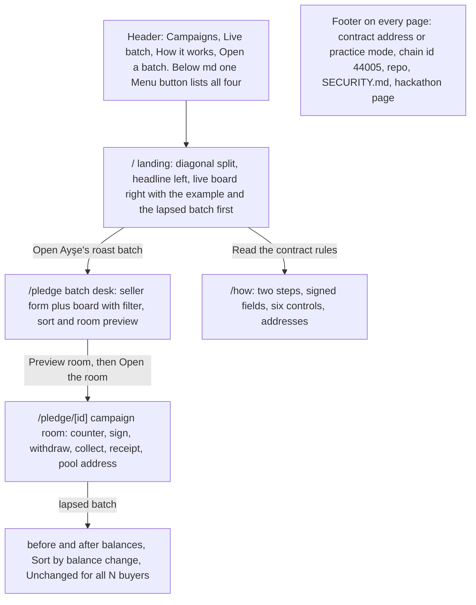

# Pactora

Pactora is pre-orders for small makers on Aevum testnet: buyers only sign a tUSD8 authorization, and when enough orders arrive every payment is collected in one transaction. If the batch falls short, nobody's money ever moves, so there is no refund to chase.

> Live demo: https://pactora-smoky.vercel.app

The live URL runs on sample data until the QuorumPool redeploy is done; every page says so in its mode line: "Sample data: QuorumPool is not deployed on this build yet, so this page shows seeded batches and practice wallets." With the real adapter on, the same line reads "Live on Aevum testnet (44005): reads come from QuorumPool at ..., writes go through the gasless relayer."

## Try it in 60 seconds

1. Open https://pactora-smoky.vercel.app. The board on the right puts Ayşe's Guji batch (3 of 5 signed) and the lapsed Peru lot (closed at 3 of 5) on top.
2. Press **Open Ayşe's roast batch**. The batch desk opens at `/pledge?example=kavruk-guji` with min 5, 2 tUSD8, 24 h loaded. Press **Open batch**.
3. Press **Preview room** on the Guji row, then **Open the room** (`/pledge/kavruk-guji`).
4. Press **Count me in** twice. The counter reaches 5/5. Press **Collect all payments**: the receipt shows one settle tx, five transfers of 2 tUSD8 and 10 tUSD8 to the roaster.
5. Open `/pledge/kavruk-peru-lapsed`: three buyers, every balance identical before and after.

No wallet, key or faucet is needed for this path; practice wallets stand in and the screen says so. The full 90-second script is in [DEMO.md](DEMO.md).

## The problem

A coffee roaster won't fire the drum for a new lot until five bags are sold. A risograph shop needs twenty prints to cover a new master. A tailor buys linen by the full 40 m bolt. All of them sell against a minimum order, and today they collect pre-orders one of two ways:

1. **Take the money up front** and promise a refund if the batch falls through. The buyer carries the risk and the maker inherits a pile of refund chores.
2. **Collect promises** in a group chat. When the threshold is met, roughly half the names go quiet at payment time.

On-chain crowdfunding contracts don't fix this. They lock funds inside the contract, so a failed campaign makes every backer call `refund` on their own and pay gas to get their own money back.

## The solution

Each buyer signs one tUSD8 `receiveWithAuthorization` (EIP-3009) message. The signature fixes four things:

- **recipient**: the Pactora `QuorumPool` contract, and only it can redeem the signature
- **amount**: the price per order
- **validBefore**: the batch deadline, so the authorization expires on its own
- **nonce**: `keccak256(pool, poolId, buyer, round)`, bound to this pool and this buyer

The relayer posts the signature to the pool (the buyer pays no gas). Once the active count reaches the minimum, anyone can call `settle(poolId)`. The contract redeems every authorization in the same transaction and forwards the total to the seller. If any single redemption fails, the whole transaction reverts. If the minimum is never met, the signatures expire and there is nothing to refund, because nothing was ever transferred.

A buyer can change their mind before the deadline by signing a `CancelAuthorization`. The relayer submits it to tUSD8, then calls `withdrawPledge`, which the pool only accepts once the token reports the nonce as used.

## Architecture



Pages never call the chain directly: they read through `lib/adapter/` (`getAdapter()`), which serves `lib/data/seed.ts` in practice mode and `lib/aevum.ts` live reads in real mode, with a seed fallback when Aevum does not answer within 4 seconds.

| Piece | File | Role |
| --- | --- | --- |
| Contract | `contracts/src/QuorumPool.sol` | createPool, pledge (signature check), withdrawPledge, dropPledge, settle |
| Data adapter | `lib/adapter/` | `getAdapter()`: fake (seed data, default) or real (`ADAPTER_MODE=real` and a pool address); pages and `/api/campaigns` read through it |
| Seed data | `lib/data/seed.ts` | Eleven fixed maker batches, deterministic placeholder hashes |
| Config | `lib/config.ts` | Every env key, timeouts, the single retry, the rate limit and the `[core]` log prefix |
| Chain module | `lib/aevum.ts` | Aevum chain, ABIs, EIP-712 typed data, `loadCampaign` (multicall plus `Pledged` / `Settled` logs via `getLogsChunked`) |
| Relay endpoint | `app/api/relay/route.ts` | zod validation first, then rate limit, then the practice branch, then the live relayer |
| Relayer | `lib/relayer.ts` | Server only. Gasless pledge, cancel, settle and createPool as legacy txs; decodes the settle receipt's tUSD8 transfers |
| Edge contracts | `lib/schemas.ts`, `lib/errors.ts` | Request schemas and the `{ error, hint }` codes the UI switches on |
| Landing | `app/page.tsx` | Diagonal split: headline left, the live board right |
| Workspace | `app/pledge/page.tsx` | Sellers open a batch; the board of all batches with filter, sort and room preview |
| Result page | `app/pledge/[id]/page.tsx` | Live counter, signer list, sign / withdraw / collect, receipt, on-chain trail, copy link |
| Method | `app/how/page.tsx` | The signed fields, the two steps, six safety controls, addresses |

## How it uses QDay and Aevum

- **tUSD8 on Aevum testnet** (`0x456569838f1d43009A91ebA4263147Afd7233483`, chain id `44005`): the only token Pactora moves. The whole mechanism depends on its EIP-3009 `receiveWithAuthorization`, `cancelAuthorization` and `authorizationState`.
- **EIP-712 domain** `{ name: "tUSD8", version: "2", chainId: 44005 }`: buyers sign against it in the browser; the pool re-derives the digest from `token.DOMAIN_SEPARATOR()` and rejects any signature that doesn't recover to the buyer.
- **Aevum specifics**: Foundry builds with `evm_version = "shanghai"`, every transaction is legacy (the relayer passes `gasPrice`), and history reads walk `eth_getLogs` in 1,000-block chunks.
- **Multicall3** (`0xcA11bde05977b3631167028862bE2a173976CA11`): one RPC round trip loads a pool, its count and its entrants.

### Deployed addresses

| Item | Value |
| --- | --- |
| Live URL | https://pactora-smoky.vercel.app |
| tUSD8 | `0x456569838f1d43009A91ebA4263147Afd7233483` ([explorer](https://explorer-test.qday.info/address/0x456569838f1d43009A91ebA4263147Afd7233483)) |
| QuorumPool | Not deployed in its current version yet: the reentrancy and balance-delta changes need a redeploy, after which the address and its explorer link go here. Explorer: https://explorer-test.qday.info |
| Multicall3 | `0xcA11bde05977b3631167028862bE2a173976CA11` |

## Safety and controls

- No custody: funds sit in buyer wallets until the single settle transaction.
- Least privilege: a signature can pay one recipient (the pool), one amount, before one deadline.
- Session expiry: `validBefore` equals the deadline.
- Instant revocation: gasless `cancelAuthorization` plus `withdrawPledge`.
- All or nothing: one failed redemption reverts the whole settle.
- Bounded loops: at most 128 orders per pool (`maxOrders <= MAX_ENTRIES / 2`) and 256 distinct entrants.
- Reentrancy lock on `settle`, the only function that makes non-view token calls.
- Measured delta: `settle` reads the pool's tUSD8 balance before and after the redemptions and reverts with `ShortDelivery` if it grew by less than orders x price, before the seller is paid.
- No approvals: the app never calls `approve` and the pool never calls `transferFrom`. Wallet permissions, signature bounds and the contract address are listed in [SECURITY.md](SECURITY.md).

## Tech stack

From `package.json` and `contracts/foundry.toml`:

- Next.js 15 (App Router), React 19, TypeScript 5, Tailwind CSS 4
- viem 2 for chain reads, typed data and the relayer; zod 3 for request validation
- Motion 14 (layout morph, counter) and AutoAnimate 0.11 (list reorder)
- shadcn-style primitives on Radix Slot and class-variance-authority
- Solidity, `pragma ^0.8.20`, compiled with solc 0.8.24 for the shanghai EVM, tested with Foundry
- Aevum testnet (chain 44005), tUSD8, Vercel

## Bounty table

| Bounty | Prize | Slots | Required tech | Code file | DEMO step |
| --- | --- | --- | --- | --- | --- |
| 1st Place | **1st Place**: $800 USDT | 1 | Aevum testnet, tUSD8 | contracts/src/QuorumPool.sol | 4 |
| 2nd Place | **2nd Place**: $500 USDT | 1 | Aevum testnet, tUSD8 | components/campaign-room.tsx | 3 |
| 3rd Place | **3rd Place**: $200 USDT | 1 | Aevum testnet, tUSD8 | components/campaign-room.tsx | 6 |

Placements are automatic: one submission is ranked for all three, and this hackathon has no sponsor bounties.

Where the required tech sits: `contracts/src/QuorumPool.sol` talks to tUSD8 only through its `IERC3009Token` interface and calls `receiveWithAuthorization` for every buyer inside `settle`; `lib/aevum.ts` builds the tUSD8 EIP-712 typed data (`receiveAuthTypedData`, `cancelAuthTypedData`, domain `tusd8Domain`) that `components/campaign-room.tsx` asks the wallet to sign. Delivery checklist: [DELIVERY.md](DELIVERY.md). Submission text: [SUBMISSION.md](SUBMISSION.md).

## Quickstart

```bash
npm install
npm run dev              # http://localhost:3000, practice mode on seed data
npm test                 # zod schema tests (node:test, Node 22.6+)
npm run test:contracts   # cd contracts && forge test
npm run proof            # reads tUSD8 and the chain, runs forge test, times the demo reads, rewrites the Proof blocks
```

More scripts: `npm run seed` prints the seed count and its sha256; `npm run demo:reset` checks seed determinism and, with the relayer key set, opens a fresh live pool.

Practice mode needs no keys: the counter, sign, withdraw and collect flows run against eleven seeded batches and the relayer returns placeholder hashes.

Every page says where its data comes from in one line. With sample data: "Sample data: QuorumPool is not deployed on this build yet, so this page shows seeded batches and practice wallets." With the real adapter on: "Live on Aevum testnet (44005): reads come from QuorumPool at ..., writes go through the gasless relayer." The line follows `getAdapter().mode`, which is `real` only when `ADAPTER_MODE=real` and `NEXT_PUBLIC_CONTRACT_ADDRESS` are both set. Seeded batches stay in practice mode even then; live pools appear on the board under their pool number.

Going live on Aevum:

```bash
cp .env.example .env.local
cd contracts
PRIVATE_KEY=0x... forge script script/Deploy.s.sol --rpc-url https://rpc-test.qday.info --broadcast --legacy
# put the printed address in NEXT_PUBLIC_CONTRACT_ADDRESS, and a funded relayer key in RELAYER_PRIVATE_KEY
```

### Environment variables

All optional; with none set the app runs in practice mode. The list mirrors `.env.example`.

| Variable | Where it comes from |
| --- | --- |
| `ADAPTER_MODE` | `fake` (seed data, default) or `real`; `real` needs `NEXT_PUBLIC_CONTRACT_ADDRESS` too |
| `NEXT_PUBLIC_CONTRACT_ADDRESS` | Output of `Deploy.s.sol` |
| `NEXT_PUBLIC_CHAIN_ID` | `44005` |
| `NEXT_PUBLIC_AEVUM_RPC` | `https://rpc-test.qday.info` |
| `NEXT_PUBLIC_EXPLORER_URL` | `https://explorer-test.qday.info` |
| `NEXT_PUBLIC_TUSD8_ADDRESS`, `NEXT_PUBLIC_TUSD8_DECIMALS` | aevum-starter-kit README; `npm run proof` reads `decimals()` on chain |
| `NEXT_PUBLIC_SITE_URL` | Your Vercel domain (default `https://pactora-smoky.vercel.app`) |
| `NEXT_PUBLIC_BRAND_FILES` | Set at build time by `next.config.ts` from `public/brand/*.png`; leave empty |
| `RELAYER_PRIVATE_KEY` | Server only, secret: a testnet wallet funded from faucet.qday.info, set in Vercel env only |

## Demo path and reset

The seven [DEMO.md](DEMO.md) steps, each with the file that carries the real path and the file that takes over when the real path cannot answer. Every read fallback is code: `readCampaignList` / `readCampaign` in `lib/adapter/index.ts` (the `FALLBACK` block) serve `lib/adapter/fake.ts` seed data for that request when the live read times out, passes 4 seconds, or fails with `upstream_error` or `parse_failure`, and the page's mode line then says it shows sample data.

| Step | Route | Real path | Fallback |
| --- | --- | --- | --- |
| 1 | `/` | `app/page.tsx` via `readCampaignList` to `lib/adapter/real.ts` (`fetchCampaignList` in `lib/aevum.ts`) | `lib/adapter/fake.ts` seed board through the `FALLBACK` in `lib/adapter/index.ts` |
| 2 | `/pledge?example=kavruk-guji` | `components/batch-workspace.tsx` `createLive` (seller wallet calls `createPool`) | Practice create in `createPractice`; a live failure renders `tx-failed` with retry |
| 3 | `/pledge/kavruk-guji` or `/pledge/<poolId>` | `components/campaign-room.tsx` `join` / `withdraw` to `app/api/relay/route.ts` to `lib/relayer.ts` (`pledge`, `withdrawPledge`) | Seed slug resolves first in `fetchCampaign`; practice wallets through the relay's mock branch |
| 4 | same page | `components/campaign-room.tsx` `collect` to `submitSettle` in `lib/relayer.ts` (`settle`) | Practice settle through the mock branch; a live failure renders `tx-failed` with retry |
| 5 | `/how` | `app/how/page.tsx` reads `POOL_ADDRESS` from `lib/config.ts` | `EmptyState` when no contract address is configured |
| 6 | `/pledge/kavruk-peru-lapsed` | `app/pledge/[id]/page.tsx` via `readCampaign` (seed slug, no RPC) | Same seed record from `lib/adapter/fake.ts` |
| 7 | `/pledge`, then `/pledge/kavruk-peru-lapsed` | Sort control in `components/campaign-board.tsx` (signatures needed, deadline, price) and "Sort by balance change" in `components/campaign-room.tsx`, both client side on the server-read list | Same rows from the `FALLBACK` seed board; the sort needs no RPC |

### Layout and flow as shipped



Interaction kit, all driven by `lib/data/seed.ts` values: the board list reorders with AutoAnimate when you filter, sort or add a practice signature; "Preview room" on `/pledge` morphs the row into the room header through a Motion `layoutId`; the sort keys use signatures still needed, deadline and price per order. With `prefers-reduced-motion: reduce` every animation is off and every control still works.

`npm run demo:reset` (`scripts/demo-reset.mjs`, Node 22.6+) hashes the seed from two separate module loads and exits 1 if the hashes differ, checks that `kavruk-guji` and `kavruk-peru-lapsed` exist, and states that there is no store: practice state lives in browser memory, so a reload is the reset. With `RELAYER_PRIVATE_KEY` and `NEXT_PUBLIC_CONTRACT_ADDRESS` set it also opens a fresh live pool (min 5, 2 tUSD8, 24 h, relayer as seller) and prints its id and explorer link. Without them it prints a "Not run" line.

Wallet states (`lib/wallet-state.ts`, rendered by `components/wallet-bar.tsx`): `disconnected`, `connecting`, `wrong-network` (with a "Switch to Aevum" action), `idle`, `tx-pending`, `tx-confirmed` (tx hash with an explorer link), `tx-rejected` (the wallet was closed, nothing signed), `tx-failed` (the contract or network refused it, with the contract rule and a retry). Practice mode uses the same states with a seeded demo wallet as the connected account.

Measured by `npm run proof`:

<!-- PROOF:BEGIN demo-path -->
_Generated by `npm run proof` at 2026-11-24T11:53:14Z._

- Site `https://pactora-smoky.vercel.app`, budget 5000 ms per step
- `GET /api/campaigns`: HTTP 200, 317 ms, mode fake, 11 batches, within budget
- `GET /api/campaigns/kavruk-guji`: HTTP 200, 174 ms, mode fake, batch kavruk-guji, within budget
<!-- PROOF:END demo-path -->

## Known constraints

- Aevum runs a Shanghai EVM: contracts compile with `evm_version = "shanghai"`.
- Aevum takes legacy transactions only: `--legacy` for forge, `gasPrice` in viem.
- `eth_getLogs` is capped at 1,000 blocks per call, so history is read with `getLogsChunked`. Live campaign pages read pool events from the last 10,000 blocks (`LOG_LOOKBACK_BLOCKS`); older pools still load from the multicall, but without per-buyer sign times and the create tx link.
- The Aevum explorer verifier has been unreliable. The deployed address and commit hash go in the table above either way.
- The relay's rate limit (12 requests per minute per IP) and its idempotency map are kept in memory per server instance, so they are best effort on Vercel; across instances the contract is the backstop (`NonceUsed`, `AlreadyPledged`, `PoolClosed`).
- A buyer who empties their wallet after signing reverts the whole settle. The seller calls `dropPledge` on that buyer and settles the rest.
- Pools opened through the relayer (`submitCreatePool`, the real adapter's `createBatch`, `npm run demo:reset`) name the relayer wallet as the seller, so their payout goes to the relayer. The batch desk's live path has the seller's own wallet call `createPool`.
- Practice state (which demo wallets signed, practice receipts) lives in component memory only. A reload resets it; nothing is stored in the browser or on the server.

## Roadmap

- Per-signature balance warnings on the campaign page, read through Multicall3.
- A seller embed: one script tag that drops a live counter onto an existing shop page.
- Post-quantum signing on QDay mainnet once its ML-DSA precompile ships: the pool would verify an ML-DSA signature over the same authorization fields.

## Proof

`npm run proof` (`scripts/proof.mjs`) rewrites only the text between each `<!-- PROOF:BEGIN name -->` and `<!-- PROOF:END name -->` pair below. It reads public values only, never a key. A proof it could not run says so in one line; it never fills in output it did not get.

### tUSD8 capabilities

<!-- PROOF:BEGIN tusd8-capabilities -->
_Generated by `npm run proof` at 2026-11-24T11:53:14Z._

- Token `0x456569838f1d43009A91ebA4263147Afd7233483` on chain 44005
- `name()`: "tUSD8"
- `version()`: "2"
- `decimals()`: 6
- `DOMAIN_SEPARATOR()` matches the EIP-712 domain built from that name, version and chain 44005.
- Proxy: implementation at `0xd6be708f41b07b2f4a7b48889b8e16626e317597`; selectors checked in both bytecodes.
- `receiveWithAuthorization` (0xef55bec6): present in bytecode
- `cancelAuthorization` (0x5a049a70): present in bytecode
- `transferWithAuthorization` (0xe3ee160e): present in bytecode
- `authorizationState` (0xe94a0102): present in bytecode
<!-- PROOF:END tusd8-capabilities -->

### Chain latency

<!-- PROOF:BEGIN chain-latency -->
_Generated by `npm run proof` at 2026-11-24T11:53:14Z._

- RPC `https://rpc-test.qday.info`
- Chain id: 44005
- Latest block: 4000987
- Round trip for `eth_chainId`: 205 ms
- QuorumPool: NEXT_PUBLIC_CONTRACT_ADDRESS is not set, so the pool was not read.
<!-- PROOF:END chain-latency -->

### Contract tests

<!-- PROOF:BEGIN contract-tests -->
_Generated by `npm run proof` at 2026-11-24T11:53:14Z._

- `forge test` (pass, exit 0): Ran 1 test suite in 300.46ms (298.73ms CPU time): 14 tests passed, 0 failed, 0 skipped (14 total tests)
<!-- PROOF:END contract-tests -->

The suite (`contracts/test/QuorumPool.t.sol`, run with `npm run test:contracts`) covers the five-buyer settle with its `Settled` event, below-threshold, after-deadline, cancelled authorization, front-run, emptied wallet plus `dropPledge`, seller-only `dropPledge`, bad signature, duplicate pledge, a token that re-enters `settle` (`test_settleReentrancyReverts`), a fee-on-transfer token that delivers less (`test_settleRevertsWhenTokenDeliversLess`), and a fuzz test that settle always pays exactly orders x price.

## AI use

The Aevum Builder Challenge #1 page states no policy on AI tools. Pactora was built with AI-assisted coding: an AI coding assistant wrote and edited much of the code and docs under the builder's direction. The product idea, the mechanism, the choice of what ships and the final review are the builder's.

## License

MIT, see [LICENSE](LICENSE).
